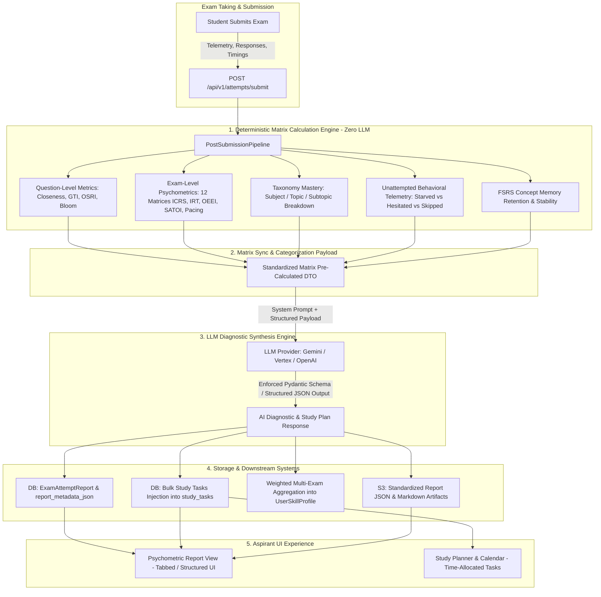
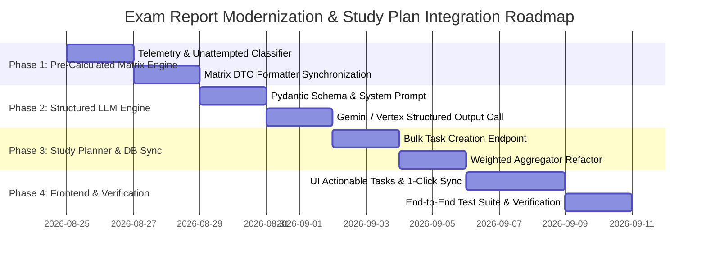

# 📊 RankEdge Exam Report Metrics, AI Insights & Study Planner Integration Specification

**Version:** 2.0  
**Status:** Architecture Design & Implementation Specification  
**Scope:** Pre-Calculated Matrix Categorization, Structured LLM Diagnostics, Exam-Type Weighted Aggregation, Unattempted Question Telemetry, and Dynamic Study Plan Action Scheduling.

---

## 🎯 Executive Summary & Purpose

The current post-exam submission reports produce accurate question-level explanations, but the overall report structure is unorthodox, fragmented, and underutilizes the rich 12-matrix psychometric dataset computed by the platform. Furthermore, the AI recommendations either fall back to deterministic hardcoded strings or lack structured, time-allocated study tasks that seamlessly flow into the student's study planner.

This document provides a comprehensive technical architecture to:
1. **Catalog & Categorize the Entire Metrics Matrix** across Question, Exam, Taxonomy, and Longitudinal levels.
2. **Standardize Pre-Calculated Data Payloads** fed into the LLM (zero mathematical hallucination; 100% deterministic numbers).
3. **Define the Structured Output Contract (Pydantic / JSON Schema)** for LLM diagnostic synthesis.
4. **Model Unattempted Question Behavioral Telemetry** (Time-Starved vs. Hesitated/Abandoned vs. Strategic Pass).
5. **Establish Multi-Exam Weighted Aggregation** across **Guest**, **Practice**, and **Full Mock** exams.
6. **Bridge AI Insights to the Aspirant's Study Planner** by generating concrete, time-allocated study tasks with 1-click or automated database scheduling.

---

## 📐 Architecture & Workflow Overview



---

## 🧩 Section 1: Complete Metrics Matrix Categorization

To ensure standardized ingestion and aggregation, all metrics are classified into **6 High-Precision Categories**:

```
┌──────────────────────────────────────────────────────────────────────────────────────────┐
│                                 RANKEDGE METRICS MATRIX                                  │
├───────────────────────────────┬───────────────────────────────┬──────────────────────────┤
│ 1. Core Performance & Marks   │ 2. Time & Pacing Telemetry    │ 3. Cognitive & Psych     │
│  - Raw / Net Marks            │  - Speed / Expected Ratio     │  - IRT 3PL Latent Theta  │
│  - Accuracy % by Category     │  - Pacing Window (Rush/Slow)  │  - GTI (Guessing Risk)   │
│  - Negative Mark Attrition    │  - Overthinking Bottlenecks   │  - OEEI (Elimination)    │
│  - UPSC Cutoff Benchmark Gap  │  - Late Exam Rush Panic       │  - SATOI (Fatigue Curve) │
├───────────────────────────────┼───────────────────────────────┼──────────────────────────┤
│ 4. Distractor & Trap Behavior │ 5. Unattempted Question Stats │ 6. Taxonomy & Retention  │
│  - Option Closeness Tier      │  - Time-Starved (Unvisited)   │  - Subject / Topic Acc   │
│  - Second-Guess Regret (OSRI) │  - Hesitated & Abandoned      │  - FSRS Memory Stability │
│  - Near-Miss Traps Captured   │  - Strategic Safe Skip        │  - Retrievability Decay  │
│  - Bloom's Thinking Level     │  - Avoidable Score Loss       │  - Strength Status Tier  │
└───────────────────────────────┴───────────────────────────────┴──────────────────────────┘
```

### 1.1 Category Breakdown Table

| Category | Level | Specific Metrics Captured | What It Represents / Impact |
| :--- | :--- | :--- | :--- |
| **1. Core Performance** | Exam / Section | • Total Marks Awarded<br>• Max Possible Marks<br>• Gross Positive Marks (+2.0/Q)<br>• Gross Negative Marks (-0.66/Q)<br>• Net Overall Accuracy %<br>• UPSC Benchmark Delta (+/- Cutoff) | Direct objective scoring and qualification gap analysis. |
| **2. Time & Pacing** | Question & Exam | • Time Taken vs. Expected Time<br>• Time Window (`FAST_RUSH`, `OPTIMAL`, `OVERTHINK_SLOW`, `BOTTLENECK_STUCK`)<br>• First-Half vs. Second-Half Pace Skew<br>• Average Seconds Per Question<br>• Pacing Status (`BALANCED`, `EARLY_BOTTLENECK`, `LATE_RUSH`) | Detects poor time budgeting, test-anxiety speedups, and fatal time sinks. |
| **3. Cognitive & Psychometrics** | Exam & Longitudinal | • **ICRS** (Integrated Cognitive Readiness Score 0-100)<br>• **IRT 3PL Latent Ability** ($\theta$ -3.0 to +3.0)<br>• **GTI** (Guessing Tendency Index 0.0 to 1.0)<br>• **OEEI** (Option Elimination Efficiency Index %)<br>• **SATOI** (Stamina & Fatigue Curve Index 0-100)<br>• **OSRI** (Option Switch Regret Index) | Evaluates intrinsic test-taking temperament, stamina drop, and gut-instinct discipline. |
| **4. Distractor & Trap Analysis** | Question | • Distractor Closeness Score (0.0 to 1.0)<br>• Distractor Classification (`Correct`, `High-Closeness`, `Plausible`, `Cognitive Trap`, `Inverse Fact`)<br>• Second-Guessing Regret (`Rewarding +2.67M`, `Costly -2.67M`, `Neutral`)<br>• Bloom's Level (`REMEMBER`, `UNDERSTAND`, `APPLY`, `ANALYZE`, `EVALUATE`) | Explains *why* the candidate picked a wrong option: was it a near-miss, inverted logic, or total guess? |
| **5. Unattempted Question Telemetry** | Question & Exam | • **`TIME_STARVED`**: 0s spent, never visited or last-minute cutoff.<br>• **`HESITATED_ABANDONED`**: Visited, >45s spent, no option selected.<br>• **`STRATEGIC_SKIPPED`**: Visited, <25s spent, discarded intentionally.<br>• Unattempted Accuracy Potential (marks lost if high-confidence topics were skipped). | Differentiates between candidate time management failure and mature risk management. |
| **6. Taxonomy Mastery & FSRS Memory** | Hierarchy & User | • Subject, Topic, Subtopic Accuracy %<br>• Strength Tier (`EXCEPTIONAL`, `STRONG`, `MODERATE`, `WEAK`, `CRITICAL_GAP`)<br>• FSRS Stability ($S$ in days)<br>• FSRS Retrievability ($R$ %)<br>• Retention Health (`OPTIMAL`, `HEALTHY`, `REVISION_DUE`, `CRITICAL_DECAY`) | Connects test mistakes to long-term memory decay and syllabus gaps. |

---

## 🔍 Section 2: Unattempted Question Behavioral Classification

One of the biggest flaws in standard exam reports is treating all unattempted questions as identical blanks. RankEdge categorizes unattempted items into 3 behavioral states:

```
                                  [QUESTION UNATTEMPTED]
                                            │
                    ┌───────────────────────┴───────────────────────┐
             Time Spent < 10s                                Time Spent ≥ 10s
                    │                                               │
         Did candidate visit in                          Candidate spent time reading
           the final 5 minutes?                             and evaluating options
                    │                                               │
          ┌─────────┴─────────┐                                     │
         YES                  NO                                    │
          │                   │                                     │
   [TIME_STARVED]     [STRATEGIC_SKIP]                    [HESITATED_ABANDONED]
   Ran out of time    Quickly recognized unfamiliar       Wasted 45s-120s reading but
   due to bottlenecks topic and prudently skipped it      lacked conviction to eliminate
```

### Pre-Calculated Unattempted Telemetry Schema

```json
{
  "unattempted_summary": {
    "total_unattempted": 22,
    "time_starved_count": 14,
    "hesitated_abandoned_count": 5,
    "strategic_skip_count": 3,
    "wasted_time_on_abandoned_seconds": 342.5,
    "missed_easy_questions_count": 6,
    "potential_marks_left_on_table": 12.0
  }
}
```

---

## ⚖️ Section 3: Exam Type Variations & Multi-Exam Weighted Aggregation

RankEdge supports three exam modalities. Each modality contributes to the student's cumulative profile with specific weightings:

### 3.1 Exam Modality Matrix

| Modality | Question Count | Duration | Scoring Rule | Primary Focus | Weight in Cumulative Profile |
| :--- | :--- | :--- | :--- | :--- | :--- |
| **Full Mock Exam (`FULL_MOCK`)** | 100 Qs | 120 Mins | Strict (+2.0 / -0.66) | Full Simulation: Stamina (SATOI), Macro Pacing, UPSC Cutoff Gap | **1.00** (Full Weight across all 12 matrices) |
| **Practice Test (`PRACTICE`)** | 10 - 30 Qs | Timed (2 min/Q) | Standard (+2.0 / -0.66) | Concept Mastery: Option Elimination (OEEI), GTI, Distractor Resistance | **0.65** (High weight on Topic Mastery & OEEI, zero weight on SATOI) |
| **Guest / Free Trial Exam (`GUEST`)** | 5 - 10 Qs | Untimed / Timed | Standard or Casual | Diagnostic Trial: Initial topic benchmark, instant conversion hook | **0.25** (Normalized baseline upon student signup) |

### 3.2 Longitudinal Weighted Aggregation Formula

When aggregating across $N$ attempts to update `UserSkillProfile` and `UserTaxonomyMastery`:

$$\text{Metric}_{\text{cumulative}} = \frac{\sum_{i=1}^N \left( \text{Metric}_i \times W_{\text{mode}, i} \times \text{Decay}_i \right)}{\sum_{i=1}^N \left( W_{\text{mode}, i} \times \text{Decay}_i \right)}$$

Where:
- $W_{\text{mode}} = 1.0$ for Full Mock, $0.65$ for Practice, $0.25$ for Guest.
- $\text{Decay}_i = e^{-\lambda \Delta t}$ accounts for recency (more recent tests reflect current mastery).

---

## 🤖 Section 4: LLM Structured Output Specification

To prevent LLM hallucination and ensure reliable UI rendering, the LLM receives **only pre-calculated numbers** and outputs a **strict Pydantic JSON schema**.

### 4.1 Input Payload Sent to LLM (Pre-Calculated Matrix DTO)

```json
{
  "candidate": {
    "user_id": "8f3b12a9-5c12-4d33-91ab-ee92019a12bc",
    "name": "Arjun Sharma",
    "target_exam": "UPSC CSE Prelims"
  },
  "exam_metadata": {
    "attempt_id": "2e2313d4-b8ec-4cc2-a48e-efd0d4af745b",
    "exam_title": "GS Paper 1 - Full Length Mock 04",
    "mode": "EXAM",
    "total_questions": 100,
    "allocated_duration_minutes": 120
  },
  "precalculated_metrics": {
    "scoring": {
      "net_score": 86.67,
      "max_score": 200.0,
      "qualifying_cutoff": 92.0,
      "cutoff_margin": -5.33,
      "accuracy_percentage": 68.2,
      "attempted_count": 78,
      "unattempted_count": 22,
      "correct_count": 52,
      "incorrect_count": 26,
      "gross_positive_marks": 104.0,
      "negative_marks_lost": 17.33
    },
    "psychometrics": {
      "icrs_score": 72.5,
      "readiness_tier": "MODERATE_DEVELOPING_READINESS",
      "irt_latent_theta": 0.42,
      "percentile_rank": 66.8,
      "gti_aggregate": 0.38,
      "gti_category": "ELEVATED_IMPULSIVE_RISK",
      "oeei_score_pct": 62.5,
      "satoi_score": 68.0,
      "stamina_drop_quarter": "Q4_FATIGUE_DROP",
      "pacing_status": "EARLY_BOTTLENECK_OVERTHINK",
      "avg_seconds_per_question": 88.4,
      "switch_regret_index": 0.45,
      "negative_switches_count": 4,
      "positive_switches_count": 1
    },
    "unattempted_analysis": {
      "time_starved": 14,
      "hesitated_abandoned": 5,
      "strategic_skip": 3,
      "wasted_time_on_abandoned_sec": 310
    },
    "distractor_vulnerability": {
      "high_closeness_traps_fallen": 11,
      "inverse_fact_traps_fallen": 6,
      "neutral_distractor_misses": 9
    },
    "blooms_mastery": {
      "REMEMBER": 78.0,
      "UNDERSTAND": 72.0,
      "APPLY": 65.0,
      "ANALYZE": 48.0,
      "EVALUATE": 40.0
    },
    "weak_taxonomy_areas": [
      {
        "subject": "Economy",
        "topic": "Monetary Policy",
        "subtopic": "Repo Rate Transmission",
        "accuracy": 33.3,
        "missed_questions": [14, 28],
        "fsrs_stability_days": 1.2,
        "retention_health": "CRITICAL_MEMORY_DECAY"
      },
      {
        "subject": "Environment",
        "topic": "Biodiversity Conservation",
        "subtopic": "National Parks & Species",
        "accuracy": 40.0,
        "missed_questions": [45, 62, 71],
        "fsrs_stability_days": 2.0,
        "retention_health": "REVISION_RECOMMENDED_SOON"
      }
    ],
    "strong_taxonomy_areas": [
      {
        "subject": "Polity",
        "topic": "Parliament & State Legislature",
        "accuracy": 88.9,
        "fsrs_stability_days": 6.5,
        "retention_health": "OPTIMAL_LONG_TERM_STABILITY"
      }
    ]
  }
}
```

### 4.2 LLM Response Schema (Pydantic Contract)

```python
from pydantic import BaseModel, Field
from typing import List, Optional
from enum import Enum

class PriorityEnum(str, Enum):
    CRITICAL = "CRITICAL"
    HIGH = "HIGH"
    MEDIUM = "MEDIUM"
    LOW = "LOW"

class ActivityTypeEnum(str, Enum):
    CONCEPT_REVISION = "CONCEPT_REVISION"
    TARGETED_MCQ_PRACTICE = "TARGETED_MCQ_PRACTICE"
    ERROR_LOG_AUDIT = "ERROR_LOG_AUDIT"
    FLASHCARD_SPACED_REVIEW = "FLASHCARD_SPACED_REVIEW"
    PACING_DRILL = "PACING_DRILL"

class ActionableStudyTask(BaseModel):
    task_id: str = Field(..., description="Unique slug like 'task_econ_repo_01'")
    title: str = Field(..., description="Action-oriented title, e.g., 'Targeted Revision: Repo Transmission Mechanisms'")
    subject: str = Field(..., description="Subject name, e.g., 'Economy'")
    topic: str = Field(..., description="Topic name, e.g., 'Monetary Policy'")
    subtopic: Optional[str] = Field(None, description="Subtopic name if applicable")
    activity_type: ActivityTypeEnum = Field(..., description="Type of study activity")
    priority: PriorityEnum = Field(..., description="Task urgency based on accuracy & marks loss")
    allocated_time_minutes: int = Field(..., description="Recommended duration in minutes (e.g., 30, 45, 60)")
    due_in_days: int = Field(..., description="Target completion timeframe in days (1-7)")
    reasoning: str = Field(..., description="Data-grounded reason citing test performance, e.g., 'Accuracy dropped to 33.3% with 2 questions trapped by high-closeness distractors.'")
    action_checklist: List[str] = Field(..., description="Concrete 3-step action items for the aspirant")
    linked_question_numbers: List[int] = Field(default_factory=list, description="Question numbers in this test that triggered this task")

class CognitiveDiagnosticInsight(BaseModel):
    executive_summary: str = Field(..., description="3-4 sentence comprehensive diagnosis summarizing score, cutoff margin, and main performance driver.")
    benchmark_verdict: str = Field(..., description="Clear qualification assessment, e.g., '5.33 Marks Below Cutoff - Recoverable in 2 Weeks with Pacing & Economy Fixes'")
    
    tactical_strengths: List[str] = Field(..., description="2-3 specific behavioral and conceptual strengths observed in data")
    critical_vulnerabilities: List[str] = Field(..., description="2-3 root-cause weaknesses (e.g. overthinking in first 30 questions, panic switching, distractor traps)")
    
    pacing_and_unattempted_diagnosis: str = Field(..., description="Analysis of pacing bottlenecks and unattempted question behavior (time-starved vs hesitated)")
    distractor_trap_critique: str = Field(..., description="Analysis of why the candidate fell for specific cognitive traps and second-guess switches")
    
    study_plan_tasks: List[ActionableStudyTask] = Field(..., description="4-6 concrete, prioritized, time-allocated study tasks ready for injection into study planner")
    
    closing_mentorship_advice: str = Field(..., description="Empowering, mentor-style closing paragraph with high-yield focus for the upcoming week.")
```

---

## 📅 Section 5: Study Planner Auto-Sync & Task Injection

When the LLM generates `study_plan_tasks`, the backend can either **auto-schedule** them into the database or present them in the UI with a **"1-Click Add All to Study Plan"** button.

### 5.1 Database Task Mapping (`StudyTask` Model)

```python
async def sync_ai_tasks_to_study_planner(
    session: AsyncSession,
    user_id: uuid.UUID,
    tasks: List[ActionableStudyTask],
    auto_schedule: bool = True
) -> List[uuid.UUID]:
    """
    Persists AI-generated diagnostic tasks directly into the student's study_tasks table.
    """
    created_ids = []
    now = datetime.now(timezone.utc)
    
    for task in tasks:
        task_date = (now + timedelta(days=task.due_in_days)).date()
        desc = (
            f"🎯 [{task.activity_type.value}] ({task.allocated_time_minutes} Mins)\n"
            f"Reason: {task.reasoning}\n\n"
            f"Checklist:\n" + "\n".join([f"• {item}" for item in task.action_checklist])
        )
        if task.linked_question_numbers:
            desc += f"\n\nLinked Exam Questions: Q{', Q'.join(map(str, task.linked_question_numbers))}"
            
        study_task = StudyTask(
            user_id=user_id,
            title=f"[{task.subject}] {task.title}",
            description=desc,
            scheduled_date=task_date,
            is_completed=False,
            created_at=now,
        )
        session.add(study_task)
        created_ids.append(study_task.id)
        
    await session.commit()
    return created_ids
```

### 5.2 API Contract for Study Task Sync

- **Endpoint:** `POST /api/v1/study-plan/tasks/bulk-from-report`
- **Request Body:**
```json
{
  "attempt_id": "2e2313d4-b8ec-4cc2-a48e-efd0d4af745b",
  "task_ids_to_add": ["task_econ_repo_01", "task_env_np_02"]
}
```
- **Response:**
```json
{
  "status": "SUCCESS",
  "scheduled_tasks_count": 2,
  "tasks": [
    {
      "task_id": "8f1a2b...",
      "title": "[Economy] Targeted Revision: Repo Transmission Mechanisms",
      "scheduled_date": "2026-08-26",
      "allocated_minutes": 45
    }
  ]
}
```

---

## 🔍 Section 6: Gap Analysis of Existing Codebase

| Area | Current State in Codebase | Identified Gap | Required Fix / Modernization |
| :--- | :--- | :--- | :--- |
| **LLM Call in Pipeline** | `post_submission_pipeline.py` uses `_generate_rule_based_insight` (lines 1153-1197). LLM call is omitted/bypassed. | Generates generic 3-sentence text; no structured diagnostic breakdown. | Integrate LangChain / Vertex AI / Gemini structured output with `CognitiveDiagnosticInsight` Pydantic model. |
| **Unattempted Questions** | Treated as generic blanks in `matrix_orchestrator.py` (line 207). | Does not classify `TIME_STARVED` vs. `HESITATED_ABANDONED` vs. `STRATEGIC_SKIP`. | Track per-question telemetry (`visited_count`, `time_taken_seconds`, remaining exam time) to compute unattempted breakdown. |
| **Actionable Tasks** | `matrix_orchestrator.py` generates static strings without time estimates (lines 574-594). | No time allocation (`allocated_time_minutes`), no activity category, no auto-sync to `StudyTask`. | Update schema to generate `ActionableStudyTask` with explicit duration (e.g. 45 min) and API sync endpoint. |
| **Exam-Type Weighting** | `cumulative_analytics_aggregator.py` aggregates all attempts with equal weighting. | Practice / Guest exams skew macro stamina metrics; Full Mocks are under-weighted. | Implement `W_mode` weighting: Full Mock (1.0), Practice (0.65), Guest (0.25). |
| **Frontend Report View** | `PsychometricReportView.tsx` displays reports, but study tasks are static cards without "Add to Study Plan" trigger. | Student cannot convert report recommendations into their calendar planner. | Add "Add to Study Plan" button & sync with `/api/v1/study-plan/tasks` with visual confirmation badges. |

---

## 🚀 Section 7: Implementation Roadmap



---

## 📝 Summary of Key Deliverables

1. **Pre-Calculated Matrix Standardization**: All 12 matrices, taxonomy stats, and unattempted question classifications computed in Python in $<50\text{ms}$ with zero hallucination.
2. **Structured LLM Diagnostic Engine**: 1 single, robust structured LLM call generating high-impact root-cause explanations and time-budgeted study tasks.
3. **Seamless Study Plan Pipeline**: Auto-generation and 1-click scheduling of personalized study tasks into `study_tasks` and the student calendar.
4. **Weighted Multi-Exam Progression**: Clean mathematical aggregation across Guest, Practice, and Full Mock tests.
