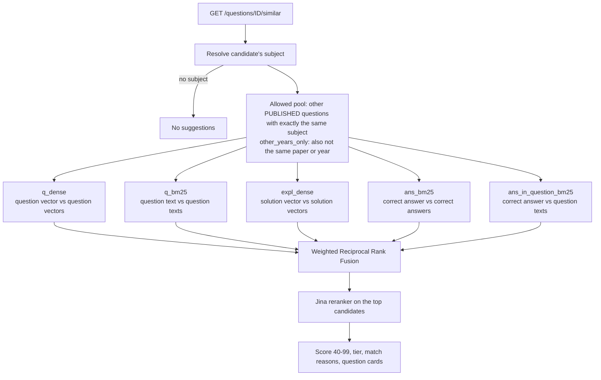

# Similar Questions — How It Works

When a student looks at a previous-year question (PYQ), the platform suggests other questions that test
the same idea or fact. This document explains how those suggestions are produced, which code is
responsible, how to run and operate it, and why it is built the way it is.

---

## 1. What the feature does

For any question (the **candidate**), `GET /api/v1/questions/{id}/similar` returns other questions that:

1. are **published**,
2. have **exactly the same subject** as the candidate (see [§4](#4-subject-rule-exact-subject-only)),
3. are ranked by how similar they are in wording, keywords, the fact being tested, and the answer.

It is shown in four places in the web app:

| Where | Component | Request |
|---|---|---|
| Signed-in practice (`/practice-exam`) — right-hand suggestions panel | `StudentPracticeExamPage.tsx` → `useSimilarQuestions` | `/similar?include_question=true` |
| Guest practice (`/guest-exam`, reached from the marketing site) — suggestions panel | `GuestExamPage.tsx` → `useSimilarQuestions` | `/similar?include_question=true` |
| Post-exam report — "Same theme in other years" under each solved question | `PsychometricReportView.tsx` → `SimilarQuestionsSection.tsx` | `/similar?include_question=true&other_years_only=true` |
| Admin Question Bank and Question Review — "Similar Questions Explorer" | `QuestionSimilarExplorer.tsx` | `/similar?include_question=true&other_years_only=<toggle>` |

---

## 2. Where the data comes from

Question papers are uploaded as PDFs and parsed by the extraction pipeline
(`apps/backend/app/pipeline/`, see its `README.md`). Every question block in a PDF looks like:

```
Q1. [Subject: Art & Culture] [Microtheme: Foreign Travellers] [Nano Theme: Ancient & Medieval Foreign Travellers] [Difficulty: Moderate]
Megasthenes visited the court of
(A) Ashoka (B) Harsha (C) Chandragupta Maurya (D) Vikramaditya
Answer: (C) Chandragupta Maurya
Solution: Megasthenes, the Greek ambassador sent by Seleucus I Nicator, visited ...
◆ Reverse Logic Box — Why the other options are wrong ...
```

What the similarity feature uses, and where it is stored:

| From the PDF | Database | Used by similarity for |
|---|---|---|
| `Subject` | `subjects` table (via the question's subtopic) and `questions.subject_raw` | **subject filter** |
| `Microtheme` | `topics` table and `questions.topic_raw` | not used for filtering |
| `Nano Theme` | `subtopics` table (`questions.subtopic_id`) and `questions.subtopic_raw` | not used for filtering |
| Question text | `question_translations.question_text` (English preferred) | question embedding + BM25 |
| Correct option | `question_options.is_correct` + `option_translations.option_text` | answer BM25 |
| Solution | `question_explanations.detailed_solution` (English) | solution embedding |

> Naming: the PDF's **Microtheme** is stored as a **Topic**, and the **Nano Theme** as a **Subtopic**.
> The hierarchy is `Subject → Topic → Subtopic`, and each question points to one subtopic.

---

## 3. The algorithm



### 3.1 Representations stored per question (`question_embeddings` table)

| Column | What it holds | Built from |
|---|---|---|
| `question_dense_embedding` | Gemini embedding (`gemini-embedding-001`, 3072 dims, stored as `halfvec`) | question text |
| `explanation_dense_embedding` | Gemini embedding | English solution (`detailed_solution`, first 8,000 chars) |
| `question_tsv` | PostgreSQL `tsvector` ('english' stemming and stop words) | question text |
| `answer_tsv` | PostgreSQL `tsvector` | correct option text |
| `question_hash`, `answer_hash`, `explanation_hash` | SHA-256 of the source texts | change detection, so unchanged texts are never re-embedded |
| `answer_dense_embedding` | **Legacy, no longer written or read** | — |

The correct-option text is deliberately **not embedded**: about half of UPSC answers are codes such as
"1 and 2 only", "Only two" or "Statement-I is correct…", and many real answers are one or two words.
An embedding of those carries no meaning (every "1 and 2 only" looks identical). The **solution**
carries the actual fact, so it is embedded instead.

### 3.2 The five retrieval channels

Each channel returns up to `SIMILARITY_CHANNEL_LIMIT` (50) question IDs **from the allowed pool only**.

| Channel | Query (candidate) | Searched against | Finds | Default weight |
|---|---|---|---|---|
| `q_dense` | question vector | other question vectors | same topic / same way of asking | 0.30 |
| `q_bm25` | question text | other question texts | shared names, terms, places | 0.25 |
| `expl_dense` | solution vector | other solution vectors | the same fact asked differently | 0.25 |
| `ans_bm25` | correct answer | other correct answers | the same answer ("Chandragupta Maurya") | 0.10 |
| `ans_in_question_bm25` | correct answer | other question texts | questions that ask *about* this answer | 0.10 |

- **Code answers are never used as queries.** `is_informative_answer()` drops answers made only of
  option codes (`1 and 2 only`, `Neither 1 nor 2`, `A-1, B-2…`, `Both A and R are true…`); for those
  questions the two answer channels are skipped.
- **Dense search is exact within the subject.** The pool is a `MATERIALIZED` CTE so PostgreSQL scans
  only the allowed questions. (An HNSW index scan would look at ~40 global nearest neighbours and filter
  afterwards, losing most same-subject matches.) A subject has at most a few thousand questions, so this
  stays fast.
- A channel with weight `0`, or without input (e.g. no solution), is skipped.

### 3.3 BM25 in plain PostgreSQL (`services/vector/bm25.py`)

PostgreSQL's built-in `ts_rank_cd` has no inverse document frequency (a word in every question,
like "consider" or "statements", counts as much as "Megasthenes"), and `plainto_tsquery` requires
**every** query word to be present. Instead, real BM25 is computed in SQL from the existing tsvectors:

```
score(D, Q) = Σ over query terms t:  idf(t) · tf · (k1 + 1) / (tf + k1 · (1 − b + b · len(D) / avg_len))
idf(t)      = ln(1 + (N − df + 0.5) / (df + 0.5))          k1 = 1.2, b = 0.75
```

- `tf` and `len(D)` come from `unnest(tsvector)` (lexeme positions).
- `df`, `N` and `avg_len` come from two small tables, **`bm25_term_stats`** and **`bm25_field_stats`**,
  recomputed by `refresh_bm25_stats()` after every vectorization run.
- Candidates are questions sharing **any** query term (an OR `tsquery`, served by the GIN index).
- No database extension is needed, so it works on managed PostgreSQL (e.g. RDS).

### 3.4 Fusion and reranking

1. **Weighted RRF:** each candidate gets `Σ weight / (k + rank)` over the channels it appeared in
   (`k = SIMILARITY_RRF_K = 60`).
2. The best `SIMILARITY_RERANK_TOP_N` (200) go to the **Jina reranker** (`jina-reranker-v3.5`) with
   `"Question: …\nCorrect Answer: …"` for both the candidate and each document.
3. The reranker score is mapped to a display percentage:
   `p = 1 / (1 + e^(−4.5·(score − 0.05)))`, `similarity_score = clamp(round(40 + 58·p), 40, 99)`.
   `tier = "exact"` when the score is ≥ 85, else `"related"`.
4. `match_reasons` lists the channels that found the question (`"Matched via q_dense"`, …).
5. With `include_question=true`, each result carries a ready-to-render question card.

If the Jina API key is missing or the call fails, the fused (RRF) order is kept.

### 3.5 Fallbacks (in `routers/questions.py`)

The hybrid search above runs first. If it raises an error or returns nothing, the endpoint falls back to:

1. **AI knowledge-tag similarity** (Jaccard overlap of `questions.knowledge_tags_ai`), when the
   candidate has AI tags.
2. **Knowledge Layer** (`app/knowledge/similarity.py`): shared entities, concepts, relationships and
   theme names — deterministic, cached for 10 minutes.

Both fallbacks pass through `_filter_by_taxonomy`, which applies the **same exact-subject rule** and
returns nothing for a candidate without a subject.

---

## 4. Subject rule: exact subject only

All subject matching lives in **`app/core/subjects.py`**:

- A question's subject is the subject of **its own subtopic** (what its card shows, and what an admin's
  correction updates); if it has none, the PDF's `subject_raw`.
- Two subjects match only if their names are equal after ignoring **case, spacing and `&` vs `and`**.
  There is no synonym list and no substring matching:
  - `Indian Polity & Governance` = `indian polity and governance` ✔
  - `History` ≠ `Modern History` ≠ `History & Culture` ✘
  - `Science & Tech` ≠ `Science & Technology` ✘
- **Only the question's main subject counts.** `question_hierarchy_links` may also link a question to
  extra concepts in other subjects (left over from the old AI explanation pipeline, mainly on the
  2022/2023 UPSC papers); those links are ignored for subject matching.
- A question without any subject gets no suggestions.

The same normalization exists in four places and **must stay identical**:

| Where | Function |
|---|---|
| Python | `normalize_subject()` in `app/core/subjects.py` |
| Raw SQL (similarity service) | `subject_sql_expr()` in `app/core/subjects.py` |
| SQLAlchemy (question lists; also works on SQLite for tests) | `subject_norm_column()` in `app/core/subjects.py` |
| Frontend | `normalizeSubject()` / `isSameSubject()` in `apps/frontend/src/services/similarQuestionService.ts` |

The rule is also used by the **question-list subject filter** (`list_questions_filtered` in
`app/repositories/question_repository.py`), which builds practice sessions, the "recommended" pool,
subject-wise tests and the admin bank filter — so a "History" session contains only History questions.

---

## 5. Code map

### Backend (`apps/backend/`)

| File | Responsibility |
|---|---|
| `app/routers/questions.py` → `get_similar_questions` | The `/similar` endpoint: hybrid search, other-years filter, fallbacks, response shape |
| `app/services/vector/similarity_retrieval_service.py` → `HybridSimilarityService` | Subject pool, five channels, RRF, reranking, scoring, cards; `is_informative_answer()` |
| `app/services/vector/bm25.py` | BM25 search in SQL and `refresh_bm25_stats()` |
| `app/services/vector/gemini_embedder.py` | Gemini `embedContent` client (retries, back-off on 429) |
| `app/services/vector/jina_reranker.py` | Jina rerank client (falls back to input order on failure) |
| `app/core/subjects.py` | Subject normalization and matching (Python, SQL, SQLAlchemy) |
| `app/db/models/question_embedding.py` | `QuestionEmbedding`, `Bm25TermStats`, `Bm25FieldStats` models |
| `app/scripts/backfill_question_embeddings.py` | CLI to (re)build embeddings, tsvectors and BM25 statistics |
| `app/tasks/vector_tasks.py` | Background vectorization of one exam (Celery if a worker is running, else asyncio) |
| `app/tasks/exam_tasks.py` | Starts vectorization (and Knowledge Layer enrichment) after a PDF is extracted |
| `app/repositories/question_repository.py` → `list_questions_filtered` | Exact main-subject filter for question lists / sessions |
| `app/knowledge/similarity.py` | Knowledge Layer fallback |
| `app/config/settings.py` | All `SIMILARITY_*`, `GEMINI_*`, `JINA_*` settings |
| `alembic/versions/073_add_question_embeddings.py` | Creates `question_embeddings` (+ HNSW and GIN indexes, `vector` extension) |
| `alembic/versions/074_explanation_embedding_and_bm25.py` | Adds the solution embedding and the BM25 statistics tables |

### Frontend (`apps/frontend/src/`)

| File | Responsibility |
|---|---|
| `services/similarQuestionService.ts` | `fetchSimilarQuestions`, `useSimilarQuestions` (per-question cache, over-fetch, excludes session questions), card mapping, `isSameSubject` |
| `pages/StudentPracticeExamPage.tsx`, `pages/GuestExamPage.tsx` | Suggestions panel: similar questions first, then the "recommended" pool; never shows a question already in the session |
| `components/exam/SimilarQuestionsSection.tsx` | "Same theme in other years" in the post-exam report |
| `components/exam/RecommendedQuestionCard.tsx` | The suggestion card (subject, topic, subtopic chips, exam and year) |
| `components/admin/QuestionSimilarExplorer.tsx` | Admin explorer with channel badges and an other-years toggle |

### Tests (`apps/backend/tests/`)

| File | Covers |
|---|---|
| `test_similarity_helpers.py` | Subject normalization/matching, code-answer detection |
| `test_subject_filter.py` | Exact main-subject filter for question lists (incl. secondary links, admin corrections) |
| `test_pyq_similar_and_sets.py` | `/similar` endpoint: other-years filter, taxonomy filter |
| `test_knowledge_layer.py` | Knowledge Layer fallback |

The hybrid search itself needs PostgreSQL with pgvector; on the SQLite test database it returns nothing
and the endpoint uses the fallbacks.

---

## 6. Running it

### Requirements

- PostgreSQL with the **pgvector** extension, version **0.7 or newer** (`halfvec`). Migration 073 runs
  `CREATE EXTENSION IF NOT EXISTS vector`.
- Python package `pgvector` (declared in `apps/backend/pyproject.toml`).
- Environment variables:

| Variable | Default | Purpose |
|---|---|---|
| `GEMINI_API_KEY` | — | Embeddings (required for vectorization) |
| `GEMINI_EMBEDDING_MODEL` | `models/gemini-embedding-001` | Embedding model |
| `GEMINI_EMBEDDING_DIM` | `3072` | Must match the `halfvec(3072)` columns |
| `JINA_API_KEY` | — | Reranker (without it, the fused order is used) |
| `JINA_RERANKER_MODEL` | `jina-reranker-v3.5` | Reranker model |
| `SIMILARITY_WEIGHT_QUESTION_DENSE` | `0.30` | Channel weights (0 turns a channel off) |
| `SIMILARITY_WEIGHT_QUESTION_BM25` | `0.25` | |
| `SIMILARITY_WEIGHT_EXPLANATION_DENSE` | `0.25` | |
| `SIMILARITY_WEIGHT_ANSWER_BM25` | `0.10` | |
| `SIMILARITY_WEIGHT_ANSWER_IN_QUESTION_BM25` | `0.10` | |
| `SIMILARITY_BM25_K1`, `SIMILARITY_BM25_B` | `1.2`, `0.75` | BM25 parameters |
| `SIMILARITY_RRF_K` | `60` | RRF constant |
| `SIMILARITY_CHANNEL_LIMIT` | `50` | Results per channel |
| `SIMILARITY_RERANK_TOP_N` | `200` | Candidates sent to the reranker |
| `SIMILARITY_FINAL_LIMIT` | `20` | Results when no `limit` is given |

### First-time setup / after deploying

From `apps/backend`:

```powershell
alembic upgrade head
python -m app.scripts.backfill_question_embeddings --all
```

### Day to day

- **New paper uploaded:** after extraction, `dispatch_exam_vectorization` embeds that exam's
  questions and solutions and refreshes the BM25 statistics automatically.
- **Questions edited:** re-run the backfill; only changed texts are re-embedded (hash check).
- Useful backfill options:

```powershell
python -m app.scripts.backfill_question_embeddings --dry-run          # what would be embedded
python -m app.scripts.backfill_question_embeddings --exam-id 12       # one exam
python -m app.scripts.backfill_question_embeddings --all --force      # re-embed everything
python -m app.scripts.backfill_question_embeddings --refresh-bm25-only
```

- Gemini rate limits (HTTP 429) are retried with back-off; a solution that still fails keeps its old
  vector and is retried on the next run.

### The endpoint

`GET /api/v1/questions/{question_id}/similar`

| Parameter | Default | Meaning |
|---|---|---|
| `limit` | 5 (1–50) | Number of results |
| `include_question` | false | Embed a question card in each result |
| `language` | `en` | Language of the embedded cards |
| `other_years_only` | false | Exclude the candidate's own paper and year ("same theme in other years") |
| `min_score`, `include_related` | — | Knowledge Layer fallback only |

Each result: `question_id`, `similarity_score` (40–99), `tier`, `match_reasons`, `question` (card),
and `source_year` with `other_years_only`. Unpublished candidates return 404 for students (staff can view them).

---

## 7. Design decisions and problems solved

These are the non-obvious choices, with the problem each one solves.

| Decision | Why |
|---|---|
| Embed the **solution**, not the correct option | Code answers ("1 and 2 only") and one-word answers have meaningless embeddings; they linked unrelated questions. |
| Skip answer channels for code answers | Otherwise every "1 and 2 only" question matches every other one. |
| Real **BM25** instead of `ts_rank_cd` + `plainto_tsquery` | The old query required every word (it matched **0** questions for a typical stem) and had no IDF. BM25 results were verified to match a Python reference exactly. |
| BM25 in SQL, no extension | Works on managed PostgreSQL; statistics are cheap to refresh. |
| Exact search inside the subject pool | Filtered HNSW scans silently dropped most same-subject neighbours. |
| **Exact** subject names, no synonym groups | Product decision: "History" must not suggest "Modern History" or "History & Culture". |
| **Main subject only** | Old AI-pipeline links put e.g. an International Relations question into History sessions. |
| Subtopic subject before PDF tag | An admin's correction must win; cards already showed the subtopic's subject. |
| Only **published** questions are suggested | Questions under review must never reach students. |
| `other_years_only` applied **before** ranking | Ranking first and filtering afterwards left the "other years" section empty whenever the candidate's own paper filled the top results. |
| Channels run sequentially | One SQLAlchemy `AsyncSession` cannot run statements concurrently. |
| Session rollback before fallbacks | A failed SQL statement aborts the transaction; the fallbacks need a usable session. |
| Practice pages hide session questions from suggestions | The "recommended" pool is fetched before the session loads and could suggest the question on screen. |

---

## 8. Known limitations and next steps

- **Computed on every request.** Each page view runs the channels and one Jina rerank call; nothing is
  cached. The planned next step is to **precompute** each question's similar list offline and update it
  incrementally when a paper is added (only pairs involving new questions change).
- **Questions without a subject get no suggestions.** Papers without `[Subject: …]` tags rely on
  Knowledge Layer enrichment to assign one.
- **Spelling variants are different subjects.** `Science & Tech` and `Science & Technology` do not match;
  keep subject names consistent at upload or in review.
- **The reranker sees the bare correct option** (e.g. "1 and 2 only") for statement-type questions.
- **Question boilerplate is not removed** ("Consider the following statements…"); BM25's IDF reduces,
  but does not remove, its effect.
- **No embedding task type** is set for Gemini; `SEMANTIC_SIMILARITY` would suit question-to-question
  search but requires re-embedding everything.
- **Quality is not yet measured.** A small labelled set (questions × graded suggestions) and nDCG@10
  would allow tuning the channel weights objectively.

---

## 9. Verifying it works

- **Tests:** from `apps/backend`,
  `python -m pytest tests/test_similarity_helpers.py tests/test_subject_filter.py tests/test_pyq_similar_and_sets.py tests/test_knowledge_layer.py -q`.
- **By hand:** `GET /api/v1/questions/<id>/similar?limit=10&include_question=true` — every result's
  `question.subject_name` must equal the candidate's subject.
- **Admin:** open a question in Question Bank or Question Review and use the Similar Questions Explorer;
  each badge shows which channel found the result.
- An audit of every question in a development database (all 499, including unpublished ones, in both
  normal and other-years mode) found **no** suggestion from a different subject.
