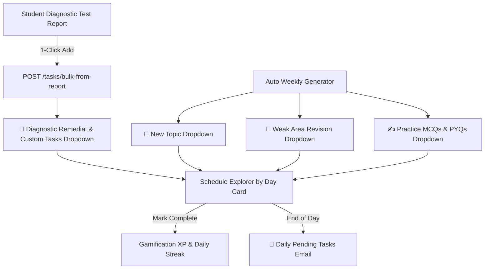

# Comprehensive Adaptive Study Planner & Study Logger — Technical Specification & Documentation

## 1. Executive Summary & Core User Experience

The **Adaptive AI Study Planner & Study Logger** is a central module of the ExamPlanner platform. It transforms **diagnostic test analytics** into a structured **weekly and daily study schedule** with **4 activity category dropdowns**, automated plan generation, and **end-of-day pending task email notifications**.

### Key Workflow Highlights:
1. **Schedule Explorer by Day (Single Dynamic Card)**: Students browse their weekly targets seamlessly using quick day pills (`[Mon (9)] [Tue (9)] ... [Fri NOW (9)]`) and a day selector dropdown.
2. **4 Categorized Dropdown Accordions**:
   - 📌 **Diagnostic Remedial & Custom Tasks**: Populated directly from post-test diagnostic reports via `POST /api/v1/study-plan/tasks/bulk-from-report`.
   - 📘 **New Topic Study Dropdown List**: Core syllabus new topics for the day.
   - 🔁 **Weak Area Revision Dropdown List**: Focused revision targets.
   - ✍️ **Practice MCQs & PYQs Dropdown List**: Sectional tests, practice quizzes, and past year questions.
3. **1-Click Task Completion**: Tasks feature direct `[ Mark Complete ]` buttons, instantly updating completion status, XP, and daily streak progress.
4. **Automated Weekly Plan Generation**: Schedules are auto-populated in the background when empty without requiring manual button clicks.
5. **Preservation & Carry-Forward Engine**: User-added custom tasks and diagnostic report tasks (`is_ai_recommended == False` or `source_attempt_id` present) are preserved across plan refreshes, while past uncompleted tasks automatically carry forward to the new week's Monday schedule.
6. **End-of-Day Pending Tasks Email Reminders**: Automated email service notifies students at the end of the day with a formatted list of remaining pending tasks.
7. **Study Session Logging**: Students can log overall study hours, questions attempted, accuracy, confidence ratings, and revision notes.

---

## 2. System Architecture & Component Structure

### 2.1 Backend (`apps/backend/`)
- **Data Models (`app/db/models/study_plan.py`)**:
  - `StudyTask`: Includes `subject`, `topic`, `priority`, `allocated_time_minutes`, `activity_type`, `is_ai_recommended`, `source_attempt_id`, `scheduled_date`, `is_completed`.
  - `StudyActivity`: Tracks study sessions with `duration_minutes`, `questions_attempted`, `questions_correct`, `confidence_rating`, `notes`.
- **Router (`app/routers/study_plan.py`)**:
  - `GET /weekly-schedule`: Returns 7-day schedule with daily task counts and logged minutes.
  - `POST /generate-weekly-plan`: Generates clean 7-day template while preserving custom tasks and carrying forward past incomplete tasks.
  - `POST /tasks/bulk-from-report`: Injects diagnostic report recommendations into planner.
  - `POST /tasks/{id}/complete`: Toggles task completion & triggers `GamificationService`.
  - `POST /send-pending-email`: Generates and sends daily pending tasks summary email.
  - `POST /activities`, `GET /activities`, `GET /activities/summary`: Manages study logging.
- **Email Service (`app/services/email_service.py`)**:
  - `send_pending_tasks_summary_email`: Sends HTML email via `FastMail` with pending tasks list.

### 2.2 Frontend (`apps/frontend/`)
- **Page (`src/pages/StudyPlannerPage.tsx`)**:
  - Streamlined Single Dynamic Card driven by Day Selector & Day Pills.
  - 4 Collapsible Category Accordions (`renderActivityCategoryDropdowns`).
  - Auto-trigger plan generation on empty load.
  - Header actions for logging study sessions.
- **Services (`src/services/studyPlannerService.ts`)**:
  - Encapsulates all backend API calls (`fetchWeeklySchedule`, `generateWeeklyStudyPlan`, `sendPendingTasksEmail`, `logStudyActivity`).

---

## 3. API Endpoints Specification

| Method | Endpoint | Description |
| :--- | :--- | :--- |
| `GET` | `/api/v1/study-plan/weekly-schedule` | Returns 7-day weekly schedule with tasks and logged study minutes. |
| `POST` | `/api/v1/study-plan/generate-weekly-plan` | Auto-generates weekly schedule template (preserves custom/report tasks & carries past pending tasks forward). |
| `GET` | `/api/v1/study-plan/tasks` | Lists study tasks for logged-in user. |
| `POST` | `/api/v1/study-plan/tasks` | Create custom study task. |
| `POST` | `/api/v1/study-plan/tasks/{task_id}/complete` | Toggle task completion, update gamification XP and streak. |
| `POST` | `/api/v1/study-plan/tasks/bulk-from-report` | Bulk inject diagnostic report recommended tasks into planner. |
| `POST` | `/api/v1/study-plan/send-pending-email` | Check and send end-of-day pending tasks email to student. |
| `POST` | `/api/v1/study-plan/activities` | Log a study session (subject, duration, MCQs solved, rating, notes). |
| `GET` | `/api/v1/study-plan/activities/summary` | Summary of logged study time, subject distribution, and questions solved. |

---

## 4. UI Layout & Category Structure



---

## 5. Database Schema Details (`app/db/models/study_plan.py`)

### 5.1 Updated `StudyTask` SQLModel
```python
class StudyTask(SQLModel, table=True):
    __tablename__ = "study_tasks"

    id: uuid.UUID = Field(default_factory=uuid.uuid4, primary_key=True)
    user_id: uuid.UUID = Field(foreign_key="users.id", index=True, ondelete="CASCADE")
    
    title: str = Field(max_length=255)
    description: Optional[str] = Field(default=None)
    
    subject: Optional[str] = Field(default=None, index=True)
    topic: Optional[str] = Field(default=None)
    subtopic: Optional[str] = Field(default=None)
    
    priority: str = Field(default="MEDIUM")  # HIGH, MEDIUM, LOW
    allocated_time_minutes: int = Field(default=30)
    activity_type: str = Field(default="CONCEPT_REVISION")  # CONCEPT_REVISION, PRACTICE_MCQS, PYQ_SOLVING, MOCK_TEST, NOTES_REVIEW
    
    scheduled_date: dt.date = Field(default_factory=lambda: datetime.now(timezone.utc).date(), index=True)
    is_completed: bool = Field(default=False)
    completed_at: Optional[datetime] = Field(default=None, sa_type=DateTimeTZ)
    
    is_ai_recommended: bool = Field(default=False)
    source_attempt_id: Optional[uuid.UUID] = Field(default=None, foreign_key="attempts.id", ondelete="SET NULL")
    
    created_at: datetime = Field(default_factory=lambda: datetime.now(timezone.utc), sa_type=DateTimeTZ)
```

### 5.2 Existing `StudyActivity` SQLModel (Study Session Logs)
```python
class StudyActivity(SQLModel, table=True):
    __tablename__ = "study_activities"

    id: uuid.UUID = Field(default_factory=uuid.uuid4, primary_key=True)
    user_id: uuid.UUID = Field(foreign_key="users.id", index=True, ondelete="CASCADE")
    date: dt.date = Field(default_factory=lambda: datetime.now(timezone.utc).date(), index=True)
    
    activity_type: StudyActivityType  # CONCEPT_REVISION, PRACTICE_MCQS, PYQ_SOLVING, MOCK_TEST, NOTES_REVIEW
    activity_source: ActivitySource = Field(default=ActivitySource.UNPLANNED) # UNPLANNED, PLANNED_TASK, DIAGNOSTIC_REMEDIAL
    
    subject: Optional[str] = Field(default=None)
    topic: Optional[str] = Field(default=None)
    duration_minutes: int = Field(default=0)
    
    questions_attempted: Optional[int] = Field(default=None)
    questions_correct: Optional[int] = Field(default=None)
    score: Optional[float] = Field(default=None)
    confidence_rating: Optional[int] = Field(default=None) # 1 to 5 scale
    
    notes: Optional[str] = Field(default=None)
    created_at: datetime = Field(default_factory=lambda: datetime.now(timezone.utc), sa_type=DateTimeTZ)
```

---

## 6. Frontend UI/UX Design & Components

### 6.1 Layout Structure (`StudyPlannerPage.tsx`)
1. **Header Banner**:
   - Current Week Navigator (e.g. `Aug 25 - Aug 31, 2026` with `←` / `→` controls).
   - Primary Action Buttons:
     - `+ Add Custom Task` (Opens `CreateTaskModal`).
     - `⏱️ Log Study Session` (Opens `LogStudyModal`).
     - `✨ Auto-Generate Weekly Plan` (Triggers AI weak-area schedule builder).
2. **View Selector Tabs**:
   - **Tab 1: Weekly Timetable (7-Day Board)**: Displays 7 daily columns (Mon - Sun). Each column shows daily target hours, scheduled task cards with priority badges, subject pill colors, and completion toggles.
   - **Tab 2: Today's Focus View**: Deep-dive into today's timeline, morning/afternoon/evening slots, task details, and instant completion.
   - **Tab 3: Diagnostic Tasks from Analysis**: Direct view of tasks imported from test reports, tagged with origin exam score & AI diagnostic rationale.
   - **Tab 4: Study Logs & Activity History**: Table of logged study sessions, total hours logged, questions attempted, accuracy, and confidence ratings.
3. **Side Summary Panel**:
   - **Weekly Completion Widget**: Circular progress indicator showing completed tasks vs total tasks.
   - **Subject Distribution Chart**: Visual bar showing study time per subject (Polity, History, Economy, Geography, etc.).
   - **Weak Areas to Revise**: Top 3 subjects needing revision derived from mock test scores.

### 6.2 Study Logger Modal (`LogStudyModal.tsx`)
Fields:
- **Subject**: Dropdown (Polity, Modern History, Economy, Geography, Environment, Science & Tech, CSAT, Current Affairs).
- **Topic**: Free text or topic selector.
- **Activity Type**: Concept Revision, Practice MCQs, PYQ Solving, Mock Test, Notes Review.
- **Duration**: Hours & Minutes inputs.
- **Questions Solved (Optional)**: Questions Attempted & Questions Correct.
- **Confidence Rating**: Interactive 5-Star rating system (1 = Very Weak, 5 = Mastered).
- **Study Notes**: Textarea for key learnings or formula highlights.

### 6.3 Diagnostic Report Integration (`PsychometricReportView.tsx`)
- Under *"Actionable Study Interventions"* in the post-exam diagnostic report:
  - Each AI task recommendation features an **"Add to Study Plan"** button.
  - Clicking sends `POST /api/v1/study-plan/tasks/bulk-from-report` with the attempt ID and task metadata.
  - Shows visual badge: `✓ Scheduled for Tomorrow (Polity)` with immediate feedback.

---

## 7. Design System & Color Tokens

All UI components will strictly utilize tokens defined in `docs/existing_color_scheme.md`:
- **Card Styling**: `backgroundColor: 'var(--bg-card)'`, `border: '1px solid var(--border-default)'`, `borderRadius: 20`
- **Polity Chip**: `#EFF6FF` background, `#2563EB` text
- **History Chip**: `#FEF3C7` background, `#D97706` text
- **Economy Chip**: `#ECFDF5` background, `#059669` text
- **Geography Chip**: `#F3E8FF` background, `#9333EA` text
- **Environment Chip**: `#F0FDF4` background, `#16A34A` text
- **High Priority Tag**: `backgroundColor: 'var(--danger-bg)'`, `color: 'var(--danger-primary)'`
- **Medium Priority Tag**: `backgroundColor: 'var(--warning-bg)'`, `color: 'var(--warning-primary)'`

---

## 8. Implementation Steps & Phasing

1. **Step 1: Backend Database & Endpoints Update**:
   - Update `StudyTask` schema in `app/db/models/study_plan.py`.
   - Add activity logging endpoints (`POST /activities`, `GET /activities`, `GET /weekly-schedule`) in `app/routers/study_plan.py`.
2. **Step 2: Frontend Service Layer**:
   - Create `apps/frontend/src/services/studyPlannerService.ts` to manage all API calls (tasks, activities, weekly schedule, report bulk sync).
3. **Step 3: Study Logger Component**:
   - Build `LogStudyModal.tsx` and connect to `POST /activities`.
4. **Step 4: Weekly & Daily Planner UI**:
   - Rebuild `StudyPlannerPage.tsx` with dynamic 7-day board, custom task creator, and live task completion state.
5. **Step 5: Diagnostic Report Sync**:
   - Wire `PsychometricReportView.tsx` "Add to Study Plan" button to backend bulk endpoint.
