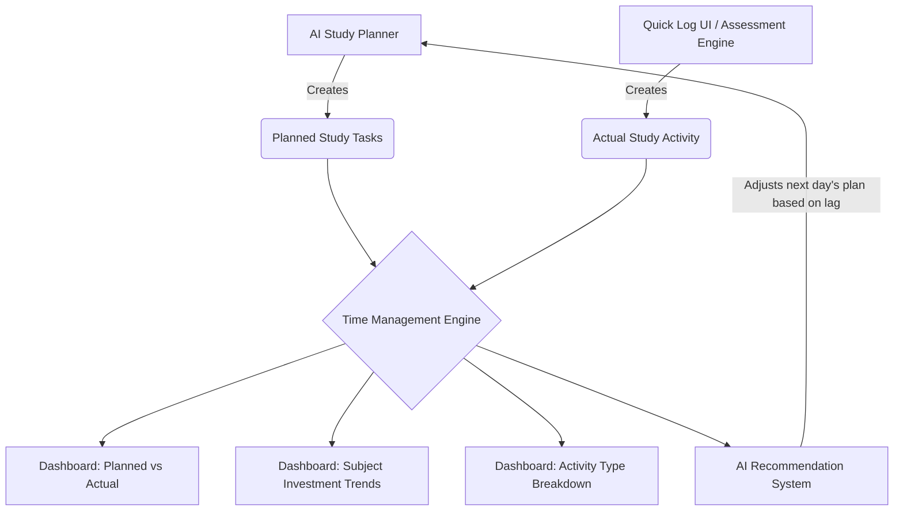

# Time Management & Study Analytics Flow - Technical Spec

## 1. Core Objective
The Time Management flow bridges the gap between **Intention (Planned Study)** and **Execution (Actual Study)**. Rather than relying on simple timers, it aggregates data logged via the `StudyActivity` engine to provide actionable insights into a student's consistency, subject biases, and actual productivity.

## 2. Architecture Diagram



## 3. Data Sources

### 3.1 Planned Data (`study_tasks` table)
- Sourced from the AI Study Planner (or manually created by the user).
- Contains an expected `scheduled_date` and an estimated duration for subjects/topics.
- *Metric:* Total Planned Hours per Day/Week.

### 3.2 Actual Data (`study_activities` table)
- Sourced manually via the "Log Activity" modal OR automatically when a user completes a Mock Test/PYQ.
- Contains the `duration_minutes`, `activity_type`, `subject`, and quality outcomes (`questions_correct`, `confidence_rating`).
- *Metric:* Total Actual Hours per Day/Week.

## 4. Key Analytics Formulas

### 4.1 Daily Completion Percentage
$$ \text{Completion \%} = \left( \frac{\text{Total Actual Minutes Today}}{\text{Total Planned Minutes Today}} \right) \times 100 $$
*(Capped at 100% for gamification display, but raw overflow can be tracked to see if a student over-studies).*

### 4.2 Study Quality Score (SQS)
Time alone isn't enough. We assign a weight to the quality of the time spent.
- **Mock/PYQ Quality:** `(Questions Correct / Questions Attempted) * 100`
- **Revision Quality:** `(Confidence Rating / 10) * 100`
- **Average Daily SQS:** The weighted average of all activity qualities for that day.

## 5. UI/UX Flow (Dashboard Integration)

### 5.1 The "Today's Study" Feed
Replaces the static Area Chart with a real-time feed.
- **Header:** Displays Total Study Time (e.g., `6h 25m`) and Completion vs Plan (`91%`).
- **Activity List:** A chronologically ordered list of today's activities.
  - 🟢 **Revision:** `Polity - Fundamental Rights (2h 15m) | Confidence: 8/10`
  - 🟣 **PYQ:** `History - Modern India (1h) | Accuracy: 80%`
  - 🟡 **Mock Test:** `UPSC CSE 2024 (2h) | Score: 104/200`

### 5.2 Weekly Analytics View (Dedicated Page)
A dedicated `/analytics/time` route providing deep-dives:
1. **Planned vs Actual (Bar Chart):** Compares planned hours vs actual hours per day over a 7-day period.
2. **Subject Investment (Pie Chart):** Percentage of time spent on Polity vs History vs Geography. Identifies neglected subjects.
3. **Activity Breakdown (Donut Chart):** Time spent on Revision vs Mocks vs New Topics.

## 6. API Endpoint Specifications

### `GET /api/v1/analytics/time-management/summary`
**Query Params:** `start_date`, `end_date`
**Response Payload:**
```json
{
  "period": "2026-08-04 to 2026-08-11",
  "total_planned_minutes": 2520,
  "total_actual_minutes": 2300,
  "completion_percentage": 91.2,
  "subject_distribution": {
    "Polity": 840,
    "History": 600,
    "Economy": 860
  },
  "activity_distribution": {
    "REVISION": 1000,
    "MOCK_TEST": 800,
    "NEW_TOPIC": 500
  },
  "daily_trend": [
    {"date": "2026-08-04", "planned": 360, "actual": 340},
    {"date": "2026-08-05", "planned": 360, "actual": 400}
  ]
}
```

## 7. AI Feedback Loop
If the Time Management Engine detects a discrepancy (e.g., student spent 5 hours on History but 0 hours on Polity despite the plan), the **AI Study Planner** will automatically:
1. Deprioritize History for the next 2 days.
2. Schedule a "Catch-up" Revision block for Polity.
3. Trigger a notification: *"You missed your Polity target yesterday. Let's start with a quick 30-min Polity revision today."*

## 8. PLANNED vs UNPLANNED Activity Mapping (The LLM Integration)

To prevent the "schedule butterfly effect" (where one off-schedule action ruins the entire AI-generated month of planning), the engine strictly differentiates between planned and unplanned activities.

### 8.1 The "Planned" Flow (Study Planner Screen)
- When the LLM generates a Daily Plan (e.g., *Polity - Fundamental Rights - 90 mins*), it is rendered on the Study Planner screen.
- When the user clicks **"Completed"**, the frontend automatically creates a `StudyActivity` record with `activity_source="PLANNED"`.
- The user does *not* need to manually re-enter this data in the Quick Log modal.

### 8.2 The "Unplanned" Flow (Quick Log Drawer)
- If the student goes rogue and studies *Geography - Climatology - 2 hours* (which the LLM didn't schedule), they log it via the Quick Log Drawer.
- This creates a `StudyActivity` record with `activity_source="UNPLANNED"`.

### 8.3 The AI Assessment & Future Planning Loop
Both `PLANNED` and `UNPLANNED` records are stored in the exact same `study_activities` table, meaning the Time Management Dashboard aggregates them seamlessly (e.g., showing 6 Total Hours = 4 Planned + 2 Unplanned).

However, the LLM uses the `activity_source` flag to make intelligent decisions for future plans:
- **Time/Behavior Insight:** *"Ah, the user studied 6 hours today, but only 4 of those hours were following my plan. They spent 2 hours on Geography."*
- **Mastery Insight:** Unplanned study time *does not* automatically grant Mastery points. Mastery is only updated if the unplanned study produces measurable academic evidence (e.g., taking a Mock test or PYQ).
- **Adjustment:** The LLM will use this behavior to adjust tomorrow's Daily Plan, without destroying the static weekly anchor plan.
